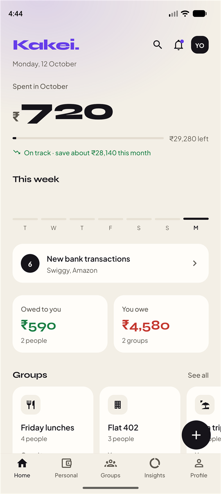
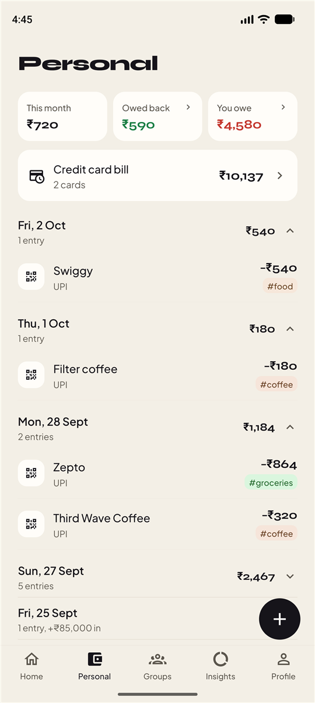
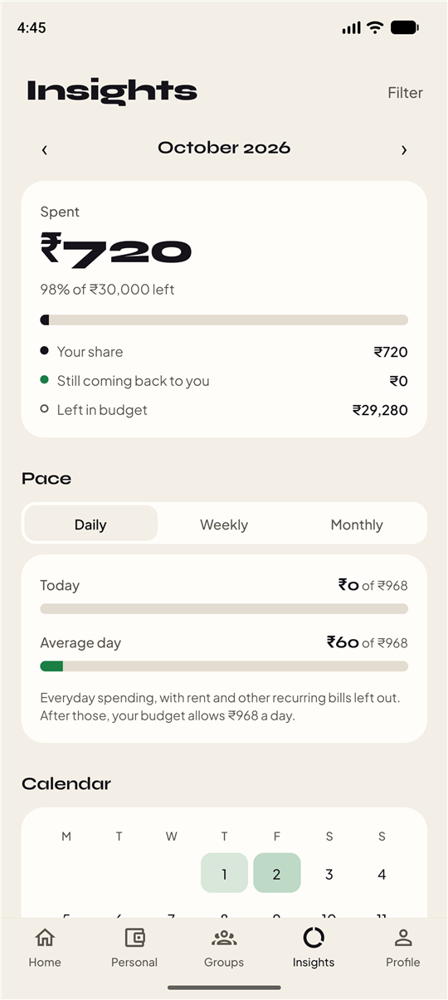
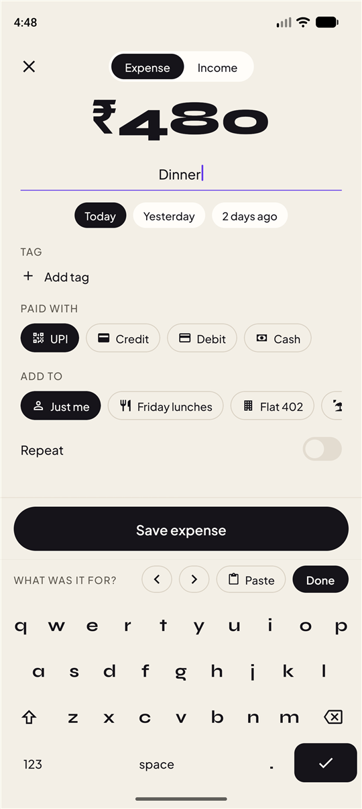
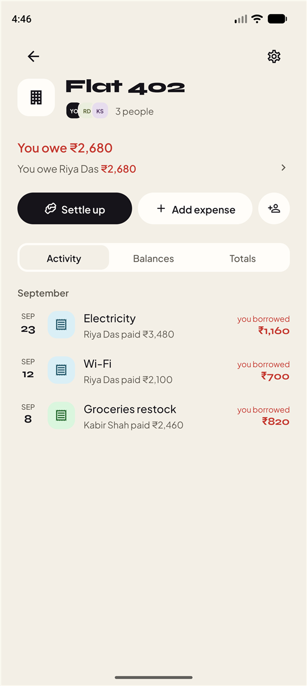
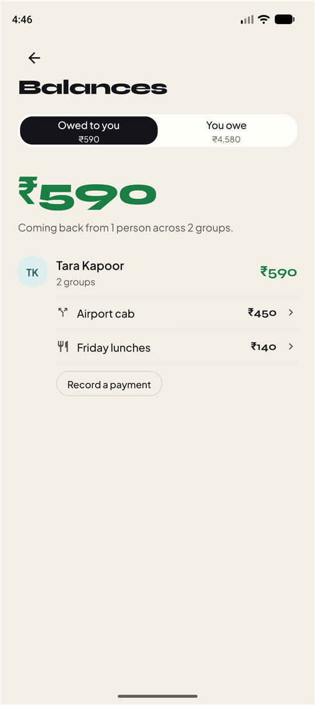
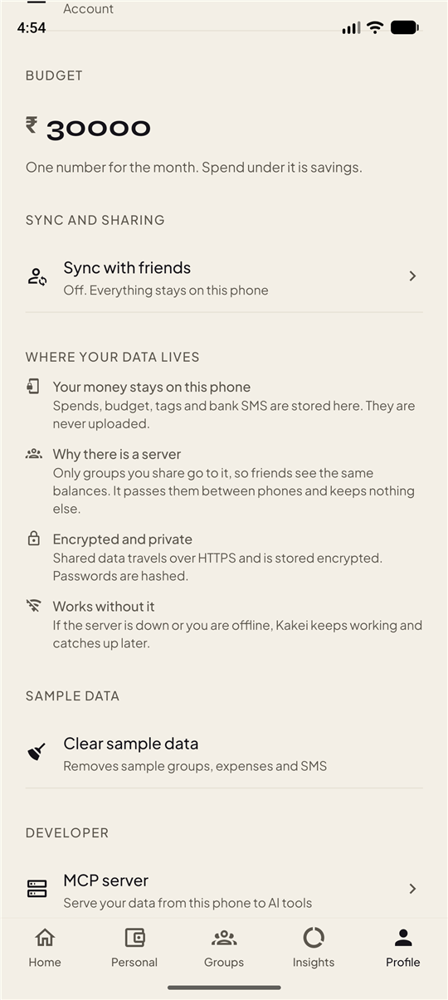

# kakei.

A privacy focused expense ledger that turns bank SMS into spends, then splits them with friends. Your money stays on your phone.

The phone app is native Android, written in Kotlin and Jetpack Compose. The API stays in `server/`.

## Screenshots

<table>
  <tr>
    <td align="center"><br /><sub>Home</sub></td>
    <td align="center"><br /><sub>Personal</sub></td>
    <td align="center"><br /><sub>Groups</sub></td>
    <td align="center"><br /><sub>Insights</sub></td>
  </tr>
  <tr>
    <td align="center"><br /><sub>Add</sub></td>
    <td align="center"><br /><sub>A group</sub></td>
    <td align="center"><br /><sub>Who owes what</sub></td>
    <td align="center"><br /><sub>Profile and privacy</sub></td>
  </tr>
</table>

## Features

**Spends from bank SMS**

- Reads bank, card and wallet messages on the phone and turns each into an expense: amount, merchant, date, rail (UPI, debit, credit, IMPS, NEFT) and a suggested tag.
- You confirm every entry before it is saved. OTPs and messages from phone numbers are skipped.
- A new bank message can post a notification. File, Other, or Not mine applies when you next open kakie.
- Paying a credit card off is a transfer, not a second spend. Card bills show what is still due, in full or in part.

**Your own money**

- Home shows this month against the budget. Personal is a day-by-day timeline. Insights charts spend by tag. Search covers the ledger.
- A monthly budget, and an optional limit on any tag. Crossing a tag limit posts a note.
- The cash widget opens Add already set to cash.

**Splitting and groups**

- Spend counts your share only. Money you paid for friends and have not got back shows separately.
- A quick split is one bill. A group is many bills over time, with one running balance.
- More than one person can have paid, and a bill can be broken into items.
- Balances lists who owes you and who you owe, by person and by group.
- Settle up records a payment. kakie does not move the money.
- Friends join with a code and see the same balances.

**Account, Pro, and Ask**

- The ledger works with no account. Profile can turn on sync when you want groups on more than one phone.
- Resetting a password texts a code. A self-hosted server prints that code in its log.
- Pro is a Play subscription: encrypted backup, Ask, the Sunday digest, and a remote MCP. A self-hosted server marks every account Pro.
- Ask answers a question about spending on this phone. The question and the tool results go to the model. SMS text does not. Ask and the Sunday digest share 30 answers a month.

## Where your data lives

kakie is local first. It works with no account and no server.

| On the phone only | Shared, sealed on the server | Encrypted backup | Remote MCP snapshot |
| --- | --- | --- | --- |
| Personal expenses, budget, tags, history | Groups, members, group expenses, settlements | The whole ledger, sealed with your account password | Amounts, merchants, tags, dates, shares |
| Bank SMS, account digits, bank names | Your name and phone, so friends can find you | The server cannot read this blob | No SMS text, account digits, or bank names |

Group changes made offline queue on the phone and send when the server is back. Signing out keeps your own spends, budget, and tags. Shared expenses are sealed at rest with AES-256-GCM. Passwords are hashed with scrypt.

The first sync after an older build asks the server to forget personal spends it used to store, once this phone has its own copy.

## Money rules

kakie does not move money. You pay however you like, then mark it paid.

- A plain expense counts in full. A split counts only your part.
- A quick split lives under Groups, then Splits. It is one bill, not a trip.
- A group is many bills and one running balance.

## Tech

| Part | What |
| --- | --- |
| App | Kotlin, Jetpack Compose, one activity (`app/`) |
| State | One local-first store (`app/src/main/java/app/kakie/lib/Store.kt`), saved as a file, with an outbox for group changes |
| SMS and MCP | `app/src/main/java/app/kakie/sms` reads the inbox, posts bank notifications, and serves MCP |
| Server | Node 22.18+ with built-in `node:sqlite` (`server/`) |
| Hosting | Docker, deployed on Coolify. A merge to `main` updates the host |

```
app/             Android app
server/src       API, SQLite, encryption
shared/          MCP tool definitions the server uses
docs/screenshots images used above
```

## Run it

The app needs Android Studio's JDK. `JAVA_HOME` should be its `jbr` when `java` is not already on PATH. The server needs Node 22.18 or newer.

### App

```bash
./gradlew :app:installDebug
```

The debug package id is `app.kakie.kt`. Release uses `app.kakie`.

The default server is `https://kakei.169.58.42.62.sslip.io`. Override it with `KAKIE_API_URL` in `.env` (see `.env.example`). On the account screen or in Profile, Change points the app at another server without a new build. The hosted one is shown as Official servers.

USB to a local server: `adb reverse tcp:4000 tcp:4000`, then use `localhost:4000`. On an emulator, `localhost` and `127.0.0.1` are rewritten to `10.0.2.2`.

```bash
./gradlew :app:testDebugUnitTest
```

### Server

```bash
npm --prefix server install
npm --prefix server start
```

Listens on `0.0.0.0:4000`. Copy `server/.env.example` to `server/.env`.

| Variable | Self-host | Hosted kakei. |
| --- | --- | --- |
| `KAKEI_EVERYONE_PRO` | `true` (the default). Every account is Pro. | `false` |
| `KAKEI_DATA_KEY` | Optional. 32 bytes, base64 or hex. Unset, the server writes `data.key` next to the database. Keep a copy. | Required, and backed up |
| `GOOGLE_SA_JSON` | Leave unset. `POST /billing/play` answers 501. | Play service-account JSON, or a path to that file |
| `SMS_OTP_URL` | Leave unset. Password reset prints the code in the server log. | URL that accepts `POST { phone, code }` |
| `GEMINI_API_KEY` | Optional. Unset, Ask answers 501. | Set, for Ask and the Sunday digest |
| `PORT` / `HOST` | `4000` and `0.0.0.0` | Behind your proxy, `HOST=127.0.0.1` |
| `DB_PATH` | `./data/kakei.db` | Wherever you keep the SQLite file |
| `CORS_ORIGIN` | `*` is fine locally | Your web origin |

```bash
npm --prefix server run typecheck
npm --prefix server run check
```

## MCP server on your phone

Profile, then Developer, then **Serve my data over MCP** turns the phone into a read-only MCP server (`POST /mcp`, bearer token). Answers are worked out on the phone. No cloud copy.

1. Turn it on. Allow the notification and the "run with the screen off" prompt. A foreground service keeps it answering after you leave the app. Do not swipe kakie away.
2. USB only (the default, loopback): plug in the phone and run `adb reverse tcp:8765 tcp:8765`.
3. On Wi-Fi or Tailscale: turn on the reachable switch and use the address shown. Do not use a mobile-data address. Nothing outside the phone can open that.
4. Paste the URL and bearer token into Cursor, Claude Desktop, or any HTTP MCP client.

Tools: `get_summary`, `list_transactions`, `spending_by_tag`, `list_groups`, `get_balances`. Never exposed: SMS text, account numbers, phone number, password. Requests with a browser `Origin` header are refused.

Pro can also publish a remote MCP. That snapshot is the ledger without SMS text, account digits, or bank names. The phone pushes it while remote MCP is on.

## Does it need the server?

No. Skip the account and the ledger stays on the phone. Spending, SMS import, quick splits, card bills, and the on-phone MCP server all work, and nothing is sent.

The server is for sharing a group, and for the encrypted backup that puts the ledger back when you log in on a new phone. Turn sync on from Profile. The backup is sealed with the account password. The server stores the blob and cannot read it.
