# kakei.

A phone ledger that turns bank SMS into spends, then splits them with friends. Your money stays on your phone. A small server only passes shared groups between phones.

<p align="center">
  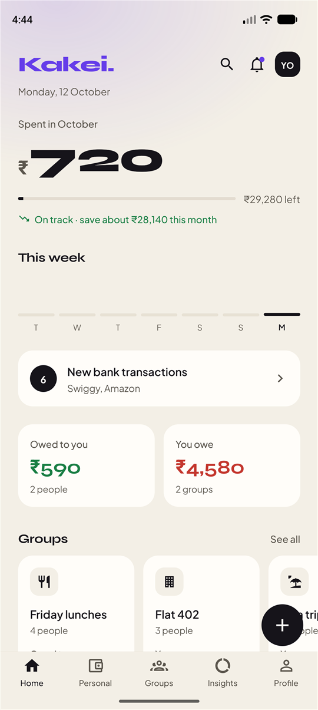
  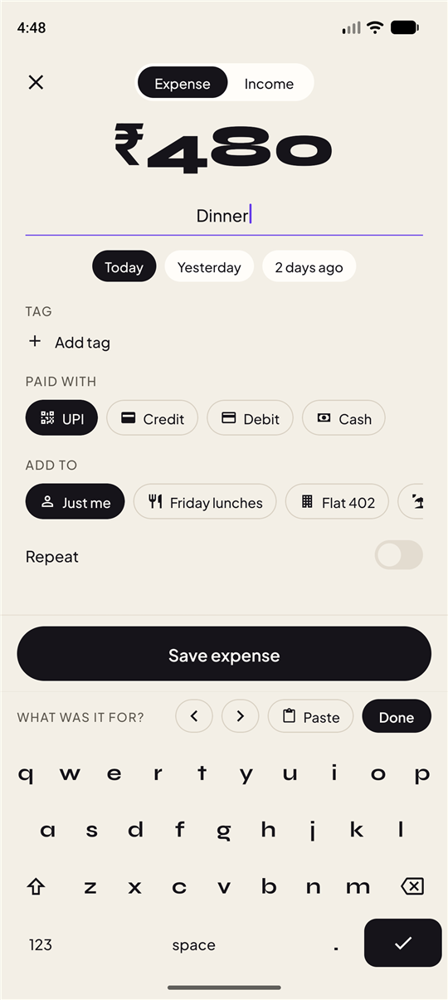
  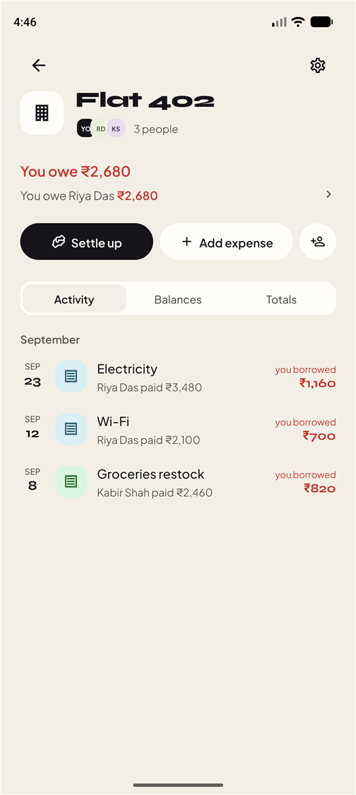
</p>

## Screenshots

### First run

<table>
  <tr>
    <td align="center">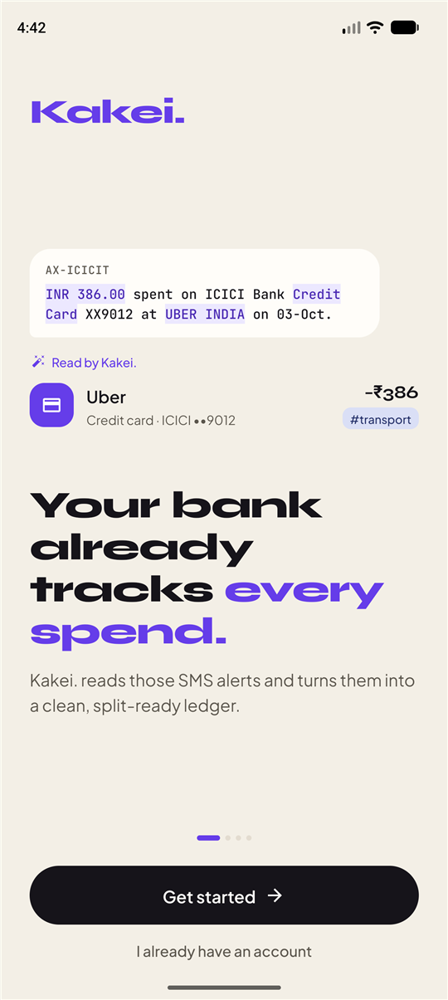<br /><sub>Welcome</sub></td>
    <td align="center">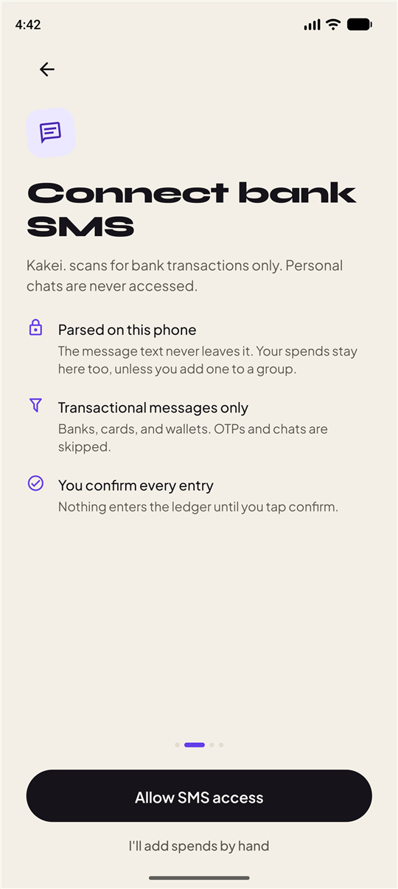<br /><sub>Connect bank SMS</sub></td>
    <td align="center">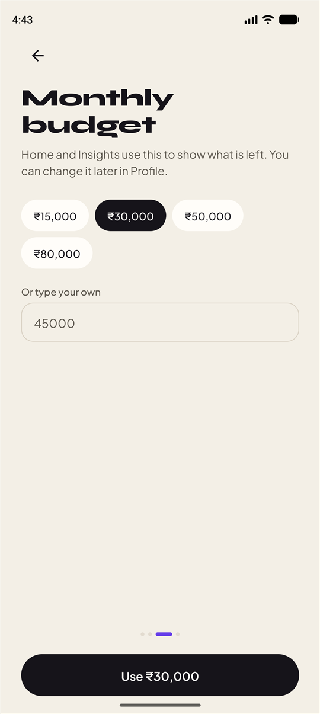<br /><sub>Monthly budget</sub></td>
    <td align="center">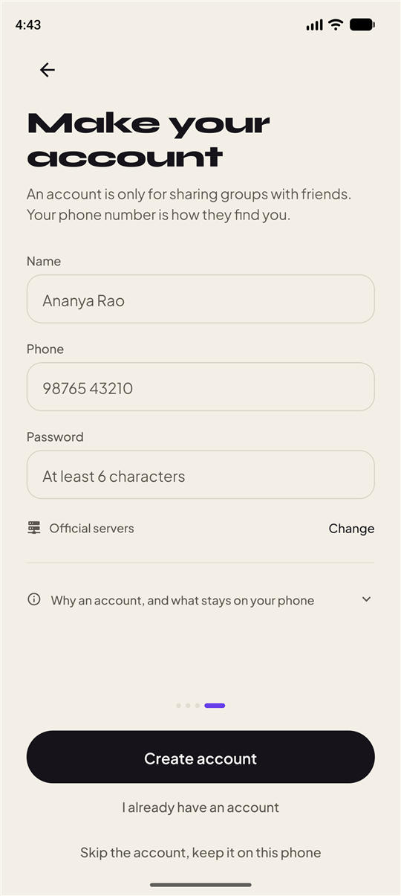<br /><sub>Optional account</sub></td>
  </tr>
</table>

### Everyday use

<table>
  <tr>
    <td align="center"><br /><sub>Home</sub></td>
    <td align="center">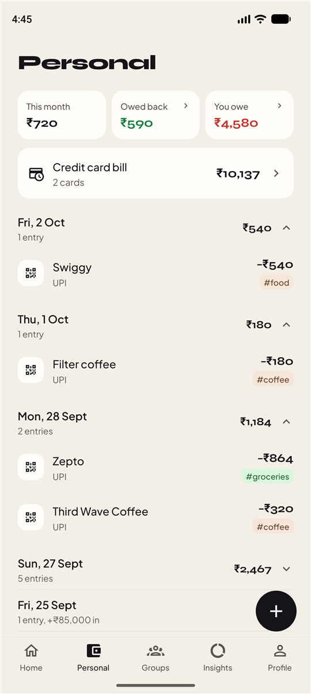<br /><sub>Personal</sub></td>
    <td align="center"><br /><sub>Groups</sub></td>
    <td align="center">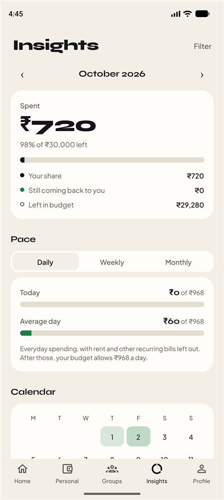<br /><sub>Insights</sub></td>
  </tr>
  <tr>
    <td align="center"><br /><sub>Add, with the built-in keyboard</sub></td>
    <td align="center"><br /><sub>A group</sub></td>
    <td align="center">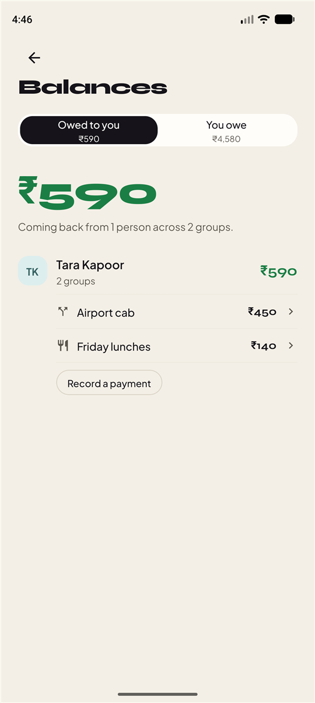<br /><sub>Who owes what</sub></td>
    <td align="center">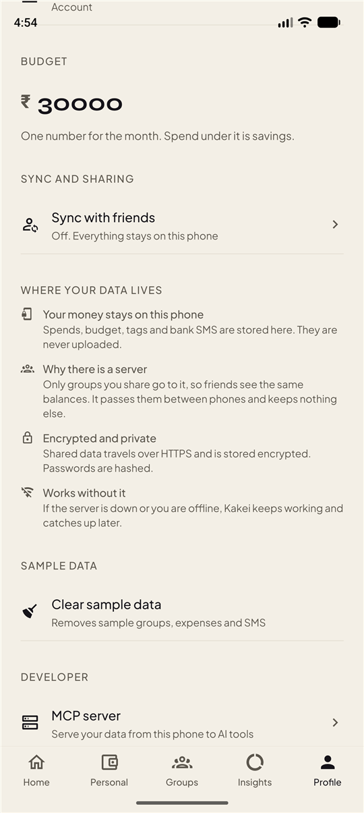<br /><sub>Profile and privacy</sub></td>
  </tr>
</table>

## Features

**Spends from bank SMS**
- Reads bank, card and wallet messages on the phone and turns each into an expense: amount, merchant, date, rail (UPI, debit, credit, IMPS, NEFT) and a suggested tag.
- You confirm every entry before it is saved. OTPs and personal chats are skipped.
- A message with ` CC ` in it is a credit card spend. Paying the card off is a transfer, not spend.
- Android reads the inbox directly. On iOS, a Shortcuts automation hands messages to Kakei.

**Your own money**
- Home with this month's spend against your budget, Personal with a day-by-day timeline, Insights with charts by tag, and search across everything.
- Credit card spends add themselves to that card's bill. **Card bills** shows what is due per card and takes full or partial payments.
- Monthly history is kept so you can compare months.

**Splitting and groups**
- Spend counts your share only. Money you paid for friends and have not got back shows separately.
- **Quick split** for a one-off bill. **Groups** for a trip, a flat or Friday lunches, with one running balance.
- Make a group from any expense, or add an expense to a group while you add it, and pick who paid.
- **Balances** lists what each person owes you and what you owe, by person and by group.
- **Settle up** is prefilled with the full amount. Edit it to pay part. Kakei does not move money, you pay however you like and mark it paid.
- Groups can be shared by code, so friends see the same balances.

**Typing**
- Kakei draws its own keyboard, so fields look and behave the same on every phone. Number pad for amounts, full keyboard for text, with a caret you can place anywhere by tapping or with the arrow keys.
- Typing is springy and interruptible. Keys dip under your finger, the caret settles on each letter, and reduced motion turns it all off.

**Developer**
- Turn the phone into a read-only [MCP](https://modelcontextprotocol.io) server so Cursor, Claude Desktop or any HTTP MCP client can ask about your spending. See [MCP server on your phone](#mcp-server-on-your-phone).

## Where your data lives

Kakei is local first. It works fully with no account and no server.

| On the phone only | On the server, only if you share a group |
| --- | --- |
| Personal expenses, budget, tags, monthly history | Groups and the people in them |
| Bank SMS text, bank names and account digits | Group expenses and settlements |
| Anything in local mode | Your name and phone number, for friends to find you |

- If the server is down or you are offline, Kakei keeps working. Group changes queue on the phone and send when it is back.
- Signing out keeps your own spends, budget and tags. Only the shared groups leave the phone, and they come back when you log in.
- Shared expenses and settlements are sealed on the server with AES-256-GCM. Account and bank digits are never sent. Passwords are hashed with scrypt, and traffic is HTTPS.
- Older versions uploaded personal spends. On the first sync after updating, the phone asks the server to forget them, but only once the phone holds its own copy.

The onboarding account step and Profile explain the same thing in the app.

## Money rules

Kakei does not move money. UPI blocks one-tap payments from an app to a person's UPI ID (NPCI rule 7.9), so you pay however you like and tap **Mark as paid** or **Mark as received**.

- **Spend is your share only.** A plain expense counts in full. A split counts only your part.
- **Quick split.** Any expense can be split with a few people. It becomes a small split under Groups > Splits and never shows in the Home carousel.
- **Group.** Many bills over time, one running balance.

## Tech

| Part | What |
| --- | --- |
| App | Expo SDK 57, React Native 0.86, Expo Router (`src/app`), React Compiler, Reanimated |
| State | One local-first store (`src/lib/store.tsx`) saved to AsyncStorage, with an outbox for group changes |
| SMS | `modules/kakie-sms`, a native Android module (inbox reading and the MCP listener) |
| Server | Node 22.18+ with built-in `node:sqlite`, no framework (`server/`) |
| Hosting | Docker, deployed on Coolify |

```
src/app          screens (every file is a route)
src/components   keyboard, input, shared UI, privacy note
src/lib          store, parser, ledger, keyboard logic, sync client
modules/         native SMS and MCP module
server/src       API, SQLite, encryption
docs/screenshots images used in this README
```

## Run it

Needs Node **22.18 or newer**.

### 1. Install

```bash
npm install
npm --prefix server install
```

Local config is copied from the examples (`.env` and `server/.env`). Both are gitignored.

### 2. Start the server (optional)

```bash
npm run server
```

Listens on `0.0.0.0:4000`. The log line `phone URL:` is the address a phone on the same Wi-Fi should use. Reload on changes with `npm --prefix server run dev`.

Settings are in `server/.env.example`. Set `KAKEI_DATA_KEY` so the data key never sits beside the database. Without it the server makes `data.key` next to the database, and you must keep a copy.

### 3. Start the app

```bash
npx expo start
```

Expo Go can open the UI. It cannot read bank SMS or run the on-phone MCP server, because both go through the native module and need an installed build.

### 4. Build an APK

Locally:

```bash
npx expo prebuild --platform android --no-install
cd android
./gradlew assembleRelease
```

The APK lands in `android/app/build/outputs/apk/release/`. Add `-PreactNativeArchitectures=arm64-v8a` to build for phones only and cut build time.

Or in the cloud with EAS:

```bash
npx eas-cli@latest login
npx eas-cli@latest build --platform android --profile preview
```

Both bake in `EXPO_PUBLIC_API_URL`, currently the Coolify server `https://kakei.169.58.42.62.sslip.io`. On the account screen, **Change** points the app at another server without a new build.

Ready-made APKs are on the [Releases page](../../releases).

### 5. Check it

```bash
npm run check      # types, app self-check, server check
npx tsc --noEmit
npx expo lint
```

## MCP server on your phone

Profile > Developer > **MCP server** turns the phone into a read-only MCP server (Streamable HTTP, `POST /mcp`, bearer token). Answers are worked out on the phone from its own data. No cloud copy, no relay.

1. Turn it on. Allow the notification and the "run with the screen off" prompt. A foreground service keeps it answering after you leave the app. Do not swipe Kakei away.
2. **USB only** (default, loopback): plug in the phone and run `adb reverse tcp:8765 tcp:8765`.
3. **Anywhere**: listens on every network. Away from home, install [Tailscale](https://tailscale.com) on the phone and the computer and use the `100.x` address shown. It is encrypted and works on mobile data.
4. Tap **Copy MCP config** and paste it into Cursor, Claude Desktop or any HTTP MCP client.

Tools: `get_summary`, `list_transactions`, `spending_by_tag`, `list_groups`, `get_balances`. Never exposed: SMS text, account numbers, phone number, password. Requests with a browser `Origin` header are refused.

The phone is not opened to the public internet. Mobile networks block inbound connections, and plain HTTP over the open internet would expose the token.

## Does it need the server?

No. Kakei starts in **local mode**: no account, no server. Spending, SMS import, quick splits, card bills and the MCP server all work from the phone, and nothing is sent anywhere.

The server is only for sharing a group with friends so every phone shows the same balances. Turn it on in Profile > **Sync with friends**. Sharing without any server would need the phones to find each other directly (Bluetooth or a QR handshake). That is not built.

## SMS module

Keep `modules/kakie-sms`. Android uses it to read the bank inbox (`readInbox`) and to run the MCP listener (`startMcp`, `stopMcp`, `mcpReply`). iOS does not read the inbox. iOS intake is the Shortcuts flow in onboarding.
